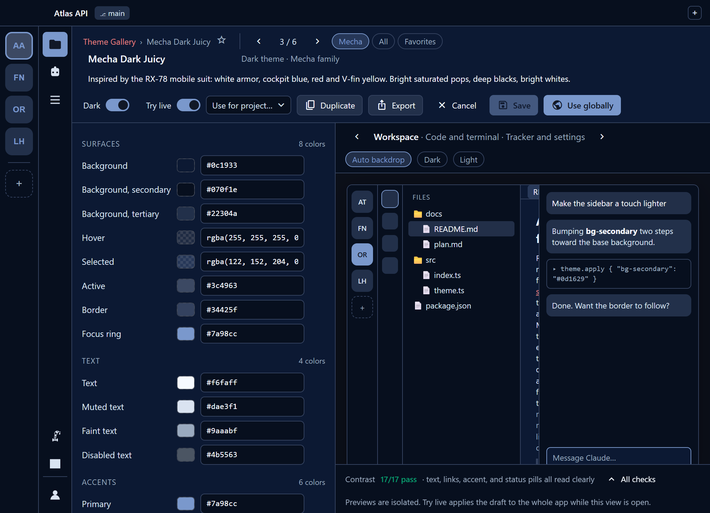
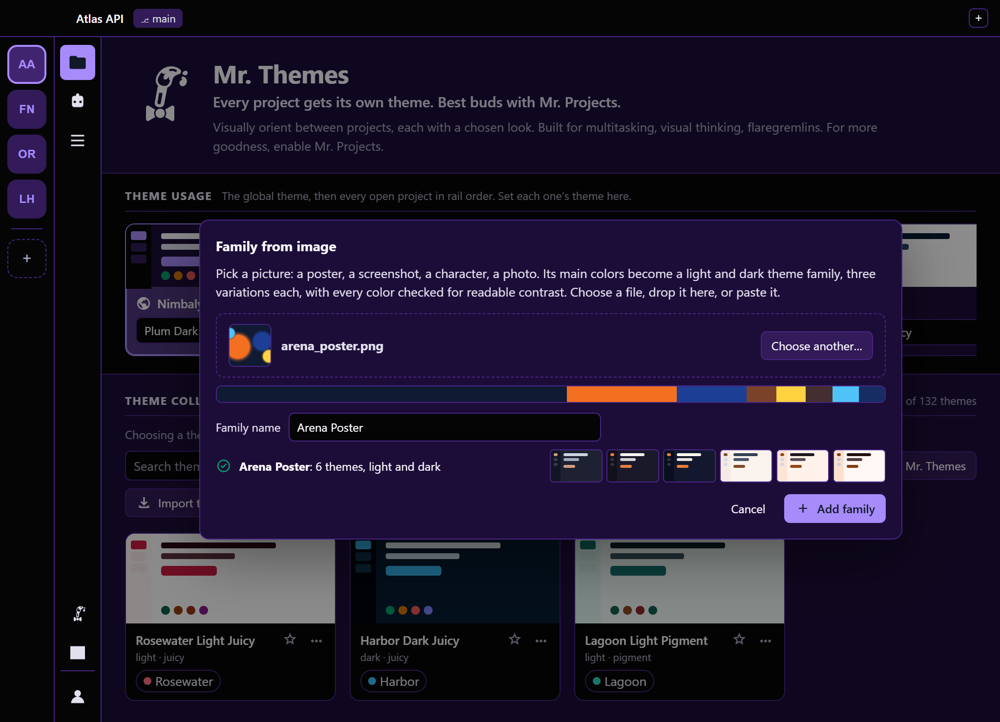
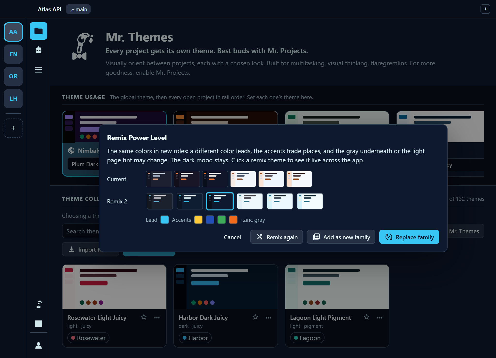
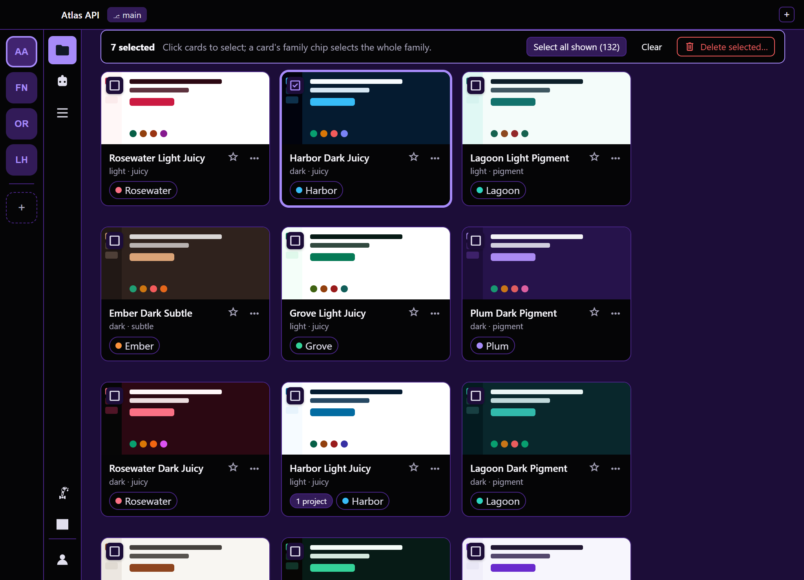
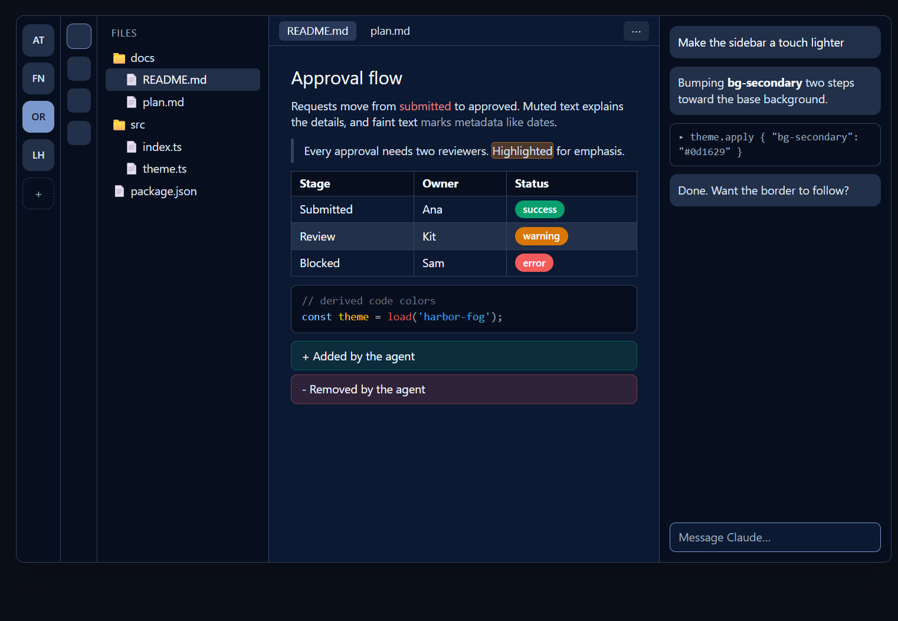
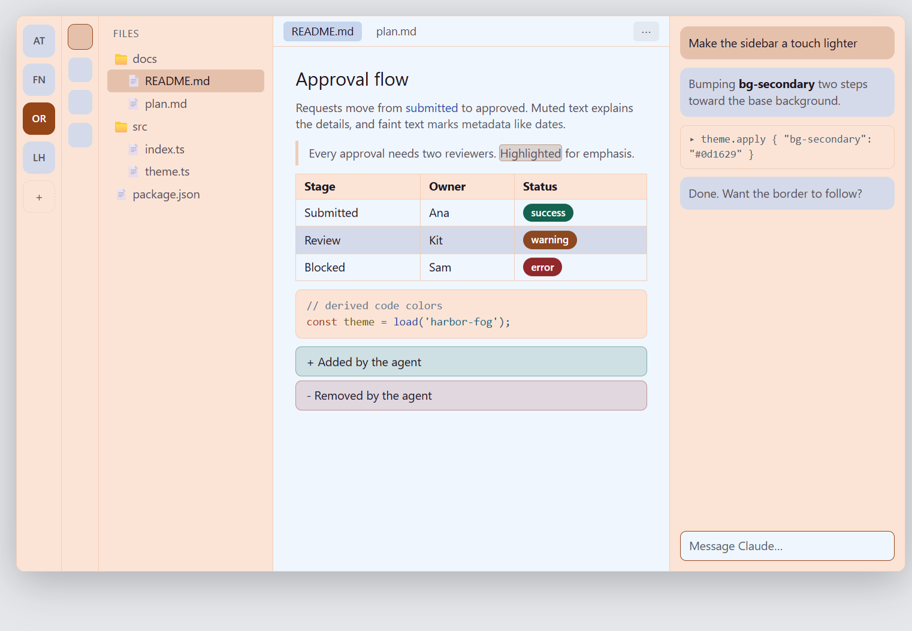

<picture>
  <source media="(prefers-color-scheme: dark)" srcset="docs/images/logo-white.svg">
  
</picture>

# Mr. Themes

**Every project gets its own theme. Best buds with Mr. Projects.**

Visually orient between projects, each with a chosen look. Built for multitasking, visual thinking, flaregremlins. For more goodness, enable [Mr. Projects](https://github.com/Firework-Labs/nimbalyst-mr-projects). An extension for [Nimbalyst](https://nimbalyst.com).

<picture>
  <source media="(prefers-color-scheme: light)" srcset="screenshots/com.fireworklabs.theme-editor-0-light.png">
  
</picture>

- 132 themes in twenty-two families, light and dark, all checked for readable contrast
- Flip through themes live with the arrows, star your favorites, or turn any image into a family
- See and change which theme each project uses
- Edit all 75 of the app's colors with a live preview (Nimbalyst's own themes can set 20)
- Share themes as files, or have your agent design a family with the included Family Builder Kit


## Install

In Nimbalyst's extension Marketplace, scroll to **Install from GitHub** and paste:

```
https://github.com/MG007Raiser/nimbalyst-mr-themes
```

This is the MG007Raiser fork. It keeps the original extension id, so your collection and settings carry over; uninstall the original first.

## What's new in this fork

- Sixteen more built-in families on top of the original six. Cyberpunk, Cobalt, Garnet, Matcha, Frost (arctic cyan), Nocturne (after-midnight purple), Bramble (retro green), Lavender (soft pastels), Arcade (neon pink), Dusk (sunset orange) and Pine (cool forest) are new in every variation. Parchment and Solar put their light themes on sepia and cream paper. Beacon is high contrast: text at 10:1 or more, accents and code at 7:1, borders at 3:1. Mecha (inspired by the RX-78 mobile suit) and Power Level (inspired by Dragon Ball Z) pin exact signature colors on top of the generator.
- Cycle through themes live: open a theme and use the arrows (or the arrow keys) to step through its family, the whole collection, or your favorites while the app follows along. Esc turns the live preview off.
- Favorites: star themes on their cards or in the editor; they get their own row at the top of the gallery.
- Family from image: pick, drop or paste a picture in Theme Families and get a light and dark family built from its colors, checked for contrast like the rest.
- Remix: on any generated family, shuffle its colors into new roles (a different lead, reordered accents, another gray), preview the remix live, then replace the family or add the remix as a new one.
- Select several themes in the Theme Collection (a card's family chip selects the whole family) and delete them at once. A family left empty goes with its last theme, and a family chip jumps to its family.
- Families added in an update arrive in your collection once, without bringing back families you deleted.
- The Family Builder Kit CLI runs on Windows and takes `--paper <hue>` and `--contrast high`.

| | |
|---|---|
|  |  |
| Flip through themes live | Family from image |
|  |  |
| Remix a family | Select and delete several themes |
|  |  |
| Mecha, dark | Power Level, light |

Goes well with [Mr. Projects](https://github.com/Firework-Labs/nimbalyst-mr-projects).

## Good to know

To theme the whole app, Mr. Themes goes a little beyond Nimbalyst's extension API, so a Nimbalyst update can leave a theme half applied until Mr. Themes catches up. Turning it off brings back Nimbalyst's own theme. More in [docs/details.md](docs/details.md).

MIT license.
